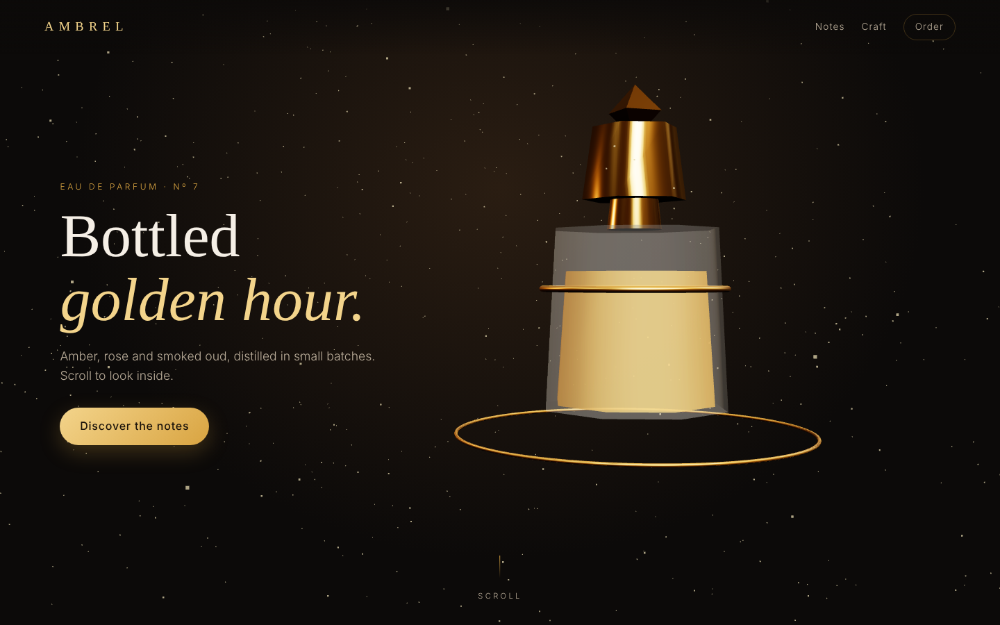
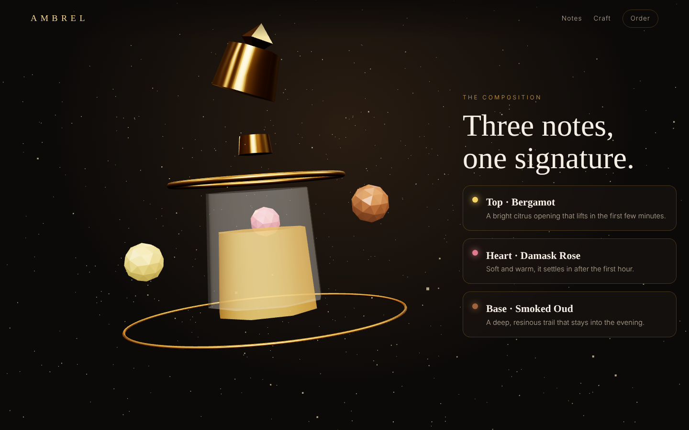
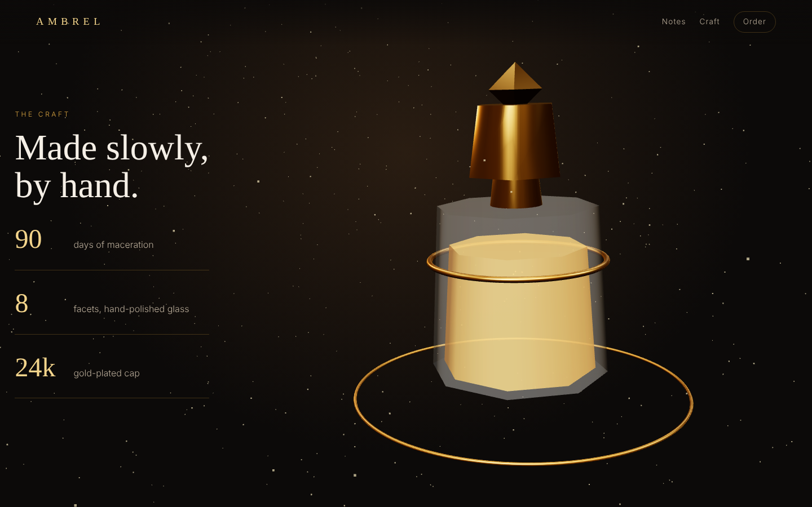
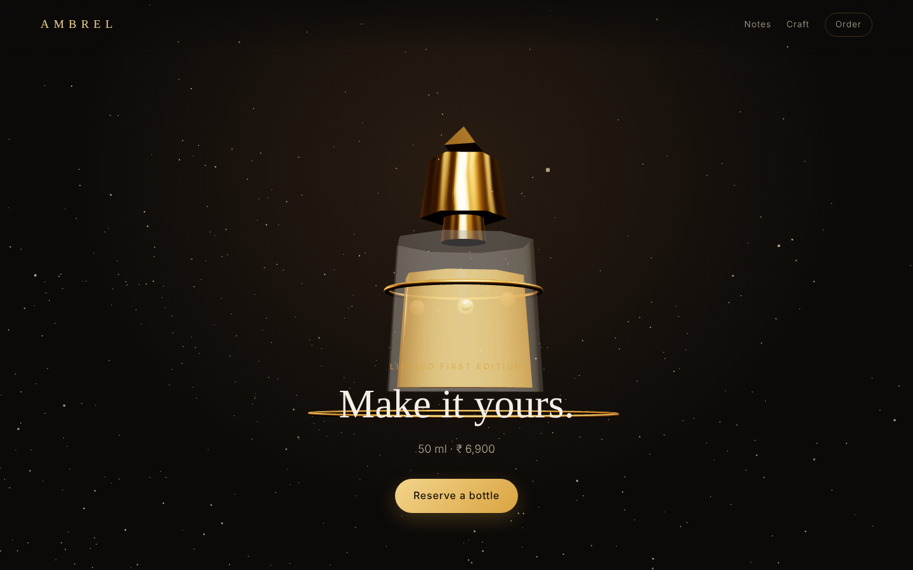
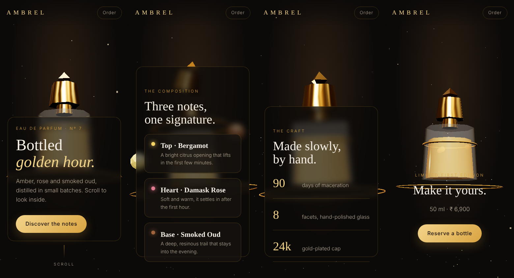

# Ambrel — 3D Scroll Product Website (Three.js)

A one-page product website where the **3D scene is written entirely in code** and rendered live in the browser with [Three.js](https://threejs.org/).
As you scroll, the camera moves and a perfume bottle **comes apart, shows its three fragrance notes, and goes back together**.

No AI images, no video, no 3D model files. Every shape (glass body, liquid, gold cap, rings, notes, particles) is created in JavaScript.

🔗 **Live demo:** https://adupuru.github.io/ambrel-3d-scroll/

> *Ambrel is a fictional brand created for this portfolio demo.*

---

## Screenshots

| Hero | Notes (bottle opens) |
|---|---|
|  |  |

| Craft (camera orbits) | Call to action |
|---|---|
|  |  |

**Mobile**



---

## Features

- **Scroll-driven 3D:** the scroll position is mapped to keyframes (camera path, bottle position, open/close, notes orbit) with smooth easing
- **Procedural modelling:** the bottle is built from Three.js primitives (cylinders, torus, octahedron, icosahedron)
- **Studio reflections without an HDR file:** uses `RoomEnvironment` and `PMREMGenerator`
- **Slide-in sections:** uses `IntersectionObserver`, with no animation library
- **Mobile-friendly:** a separate layout for phones, a capped pixel ratio and fewer particles
- **Accessible:** respects `prefers-reduced-motion`, and the content stays readable if WebGL is not available
- **Lightweight:** no build step and no framework. Three.js loads from a CDN through an import map.

## Tech stack

| Layer | Tool |
|---|---|
| 3D rendering | Three.js r160 (WebGL) |
| Markup / styles | HTML5, CSS3 (custom properties, `backdrop-filter`, `clamp()`) |
| Logic | Vanilla JavaScript (ES modules) |
| Hosting | GitHub Pages |

## Project structure

```
ambrel-3d-scroll/
├── index.html        # page sections + import map for Three.js
├── css/style.css     # layout, typography, slide-in animations, mobile rules
├── js/main.js        # 3D scene, scroll keyframes, render loop
└── screenshots/      # images used in this README
```

## Run locally

ES modules do not load from `file://`, so serve the folder over HTTP:

```bash
# Python
python3 -m http.server 8000
# or Node
npx serve .
```

Then open http://localhost:8000

## Customise

- **Colours:** change the CSS variables at the top of `css/style.css` and the material colours in `js/main.js`
- **Animation per section:** edit the `keys` array in `js/main.js`. There is one keyframe per section (`open`, `notes`, `cam`, `x`).
- **Product:** replace the bottle meshes with your own shapes, or load a `.glb` model with `GLTFLoader`

---

**Built by Harikrishna | [Websitopedia](https://www.instagram.com/harikrishna_websitopedia/)**
Need a 3D or scroll-animated website for your brand? Send me a DM on Instagram.
